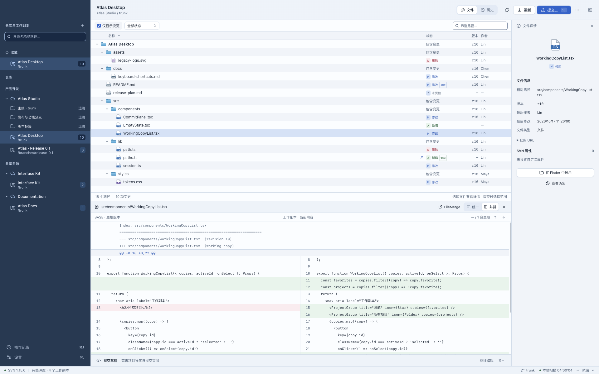
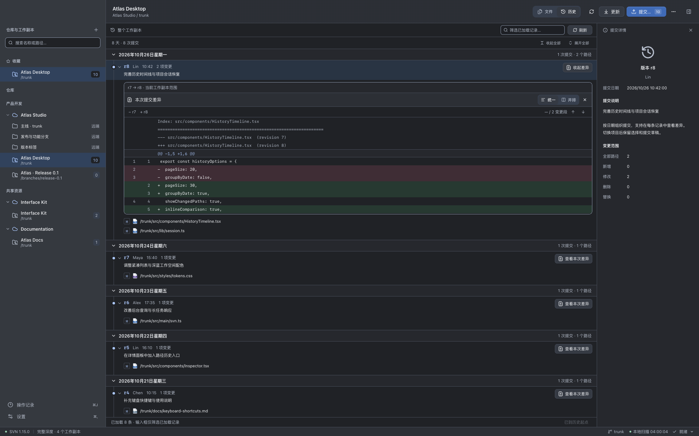
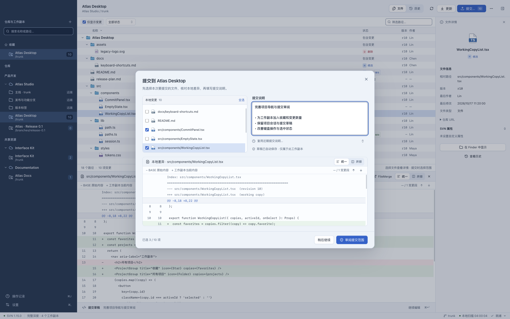
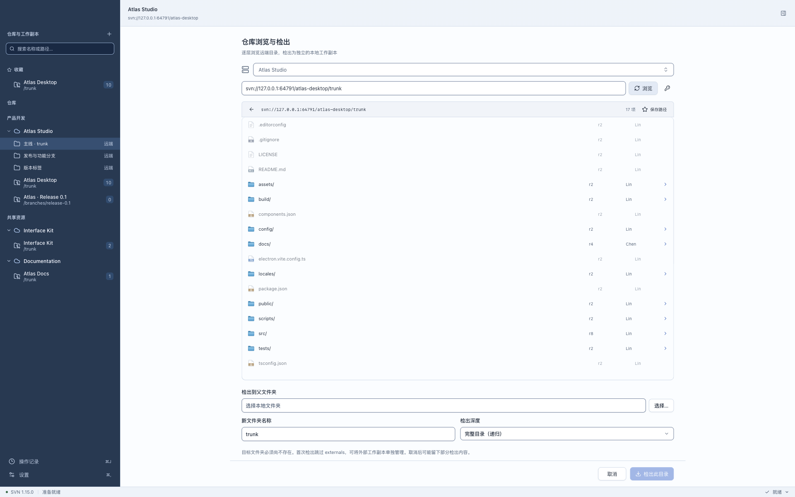
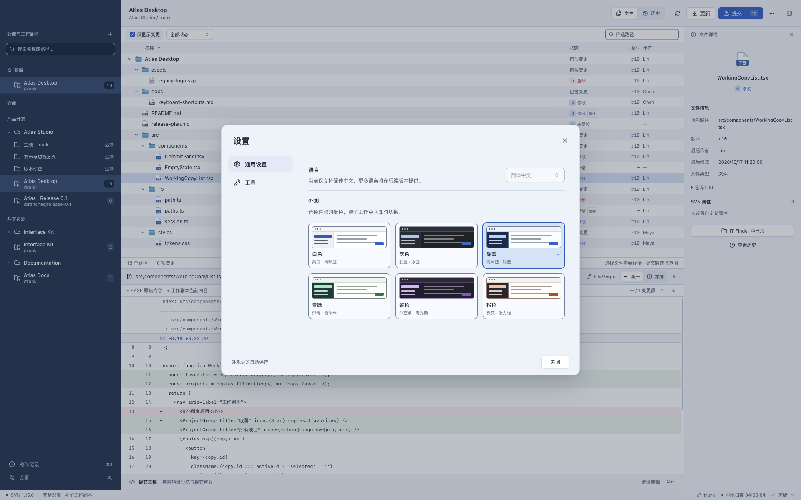

  
  <h1>svnbox · 仓盒</h1>
  

    <a href="README.md">English</a> · <a href="README.zh-CN.md"><strong>简体中文</strong></a>
  

  
在 macOS 上，给 SVN 仓库和工作副本一个家。

  

    <a href="#界面预览">界面预览</a> ·
    <a href="https://github.com/svn-box/svn-box/issues">反馈问题</a>
  

  
v0.1.0 · macOS 13+ · Apple Silicon（arm64）

仓盒是一款面向 macOS 的 Subversion 图形客户端。在同一个桌面工作区中管理多个项目，切换工作副本、审阅变更、选择文件提交和查询历史，并保留各个项目的工作上下文。

应用界面目前支持**简体中文**。

## 功能

- **多个工作副本** — 按分组整理、搜索、收藏和排序。每个副本独立保留文件选择、筛选条件、展开的目录、历史上下文和提交草稿。
- **远端路径书签** — 集中整理仓库 URL，逐层浏览目录，将不同分支检出为独立的本地工作副本。
- **变更审阅** — 紧凑的文件树、SVN 状态筛选，以及文本和属性差异。支持统一或并排显示。
- **选择性提交** — 选择本次提交的路径，审阅实际提交范围，复用近期说明，重启后恢复草稿。
- **历史时间线** — 按日期折叠记录，分页读取历史，查看变更路径，并在单次提交内展开差异。
- **SVN 操作** — 更新、添加、重命名、删除、忽略、还原和清理工作副本。查看冲突详情，打开外部比较或合并工具。
- **连接认证** — 在本机加密保存凭据，按连接或仓库路径限定适用范围，让匹配的子路径共用认证。
- **操作日志** — 查看执行状态与命令输出，取消运行中的任务，筛选、复制日志，清空已结束的记录。
- **桌面交互** — 键盘操作、右键菜单、Finder 与终端入口，以及六套外观配色。
- **内置 SVN** — 直接使用随应用提供的 Subversion，也可以在设置中指定本机可执行文件。

## 界面预览

以下截图均来自实际运行的应用，窗口尺寸为 **1920 × 1200**。项目名称、文件变更、提交说明和账号均为独立本地 SVN 仓库中的演示数据。

**工作空间** — 集中管理多个工作副本，通过紧凑文件树、并排 Diff 和详情面板审阅变更。

历史与提交差异

按日期浏览提交，展开变更路径，在时间线内直接查看本次差异。图中使用灰色主题。

选择文件与提交审阅

逐项选择本次提交的路径，检查差异，编辑保留的提交草稿，再审阅最终范围。

远端路径与仓库浏览

将远端路径书签与本地工作副本放在一起，逐层浏览仓库并选择检出目录。图中的回环地址仅用于本地演示服务器。

选择喜欢的外观

在设置中选择白色、灰色、深蓝、青绿、紫色或橙色，配色立即应用到整个工作空间。

## 使用方法

### 添加项目

按 **⌘O** 添加已有工作副本，仓盒会自动识别工作副本根目录及所属仓库。通过侧栏右键菜单修改名称和分组、收藏或调整顺序。移除管理记录只会将其从仓盒中移除。

按 **⌘⇧O** 浏览远端仓库并检出目录。输入 URL，选择本地目标位置和检出深度，需要认证时填写用户名与密码。认证可保存到整个连接，也可以仅用于当前仓库路径。

### 审阅与提交

在侧栏选择工作副本，浏览文件、仅显示变更或按 SVN 状态筛选。选择文件即可查看差异，切换统一与并排视图，也可以在 FileMerge 可用时打开外部比较。

按 **⌘↵** 准备提交，填写说明、选择文件，并在确认前审阅实际提交范围。勾选表示本次提交范围，SVN 没有暂存区。每个工作副本的草稿独立保存。

### 刷新与更新

按 **⌘R** 刷新本地状态，按 **⌘U** 从仓库更新工作副本。按 **⌘J** 打开操作日志，查看输出或取消运行中的任务。取消不会回滚已经完成的修改。

通过文件右键菜单执行添加、重命名、删除、忽略和还原等操作。有数据丢失风险的操作会在确认前展示影响范围。发生冲突时，查看详情，按需使用外部工具处理，刷新状态，再明确标记为已解决。

### 查询历史

切换到历史视图，或在文件、目录的右键菜单中查询指定路径的历史。展开日期和提交查看变更路径，在对应提交内打开差异预览。

搜索框仅筛选已经加载的记录。继续读取更早记录时，会向服务器查询下一页历史。

### 调整工作空间

拖动分栏边界调整宽度和高度，或折叠详情面板。按 **⌘,** 打开设置，选择外观、配置 SVN 与外部合并工具。重新打开仓盒后，会恢复各工作副本的上下文和提交草稿。
